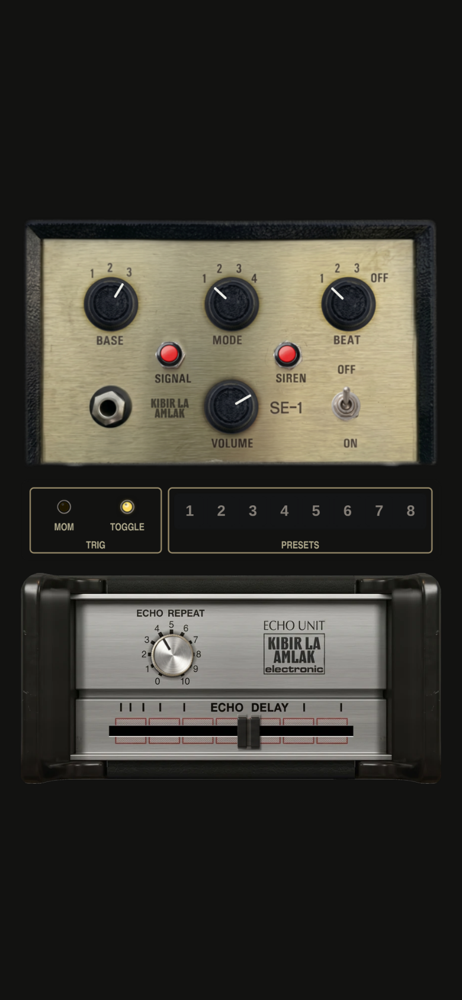

# SE-1 Siren & Echo Unit (phone)

A browser dub siren for phones by Kibir La Amlak: the SE-1 Siren running into a mono HH Echo Unit.

Open `index.html` in Chrome or Safari and tap **Power up**. It is one self-contained file, so it also works offline.

It plays over other apps: start Spotify, Apple Music or anything else first, then siren on top.

## Controls

- **TRIG**: switch the siren on. **MOM** = on while held, **TOGGLE** = each tap switches it.
- **SIGNAL**, **SIREN**: hold (two fingers work).
- **BASE**, **MODE**, **BEAT**: tap a number. **VOLUME**: drag up or down.
- **Presets 1 to 8**: tap to recall, hold to store (BASE, MODE and BEAT).
- **ECHO DELAY**: slide (60 to 600 ms). **ECHO REPEAT**: drag up or down; past 9 it runs away.

## How it works

- Siren: circuit model of the NJD SE-1 (gen~ engine transpiled to JavaScript).
- Echo: HH Echo Unit v9 tape path, mono, ECO record curve. Measured offline: repeats every 373 to 374 ms at the default delay, about 6 to 8 dB down per repeat at REPEAT 4, holds without running away at REPEAT 10.
- Both run in one AudioWorklet (ScriptProcessor fallback for older browsers).

## Rebuild

`source/` holds the page template, engines and artwork. `python3 mkweb_hh.py hh_mono.txt hh_engine.js` regenerates the echo engine; `build.py` assembles the page (it expects the SE-1 panel images from the M4L build alongside).

Switching apps pauses the page's sound on iPhone; when you come back, the first tap brings it back.
