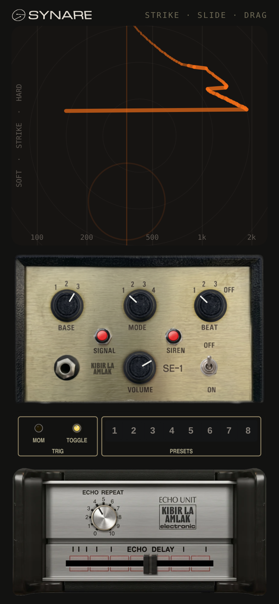

# Synare, SE-1 Siren & Echo (test)

Test version: the Synare touch pad on top, the SE-1 Siren and the mono HH Echo Unit below. The siren and the Synare both run into the echo.

Open `index.html` in Chrome or Safari and tap **Power up**.

- **Synare pad**: tap to strike (higher hits harder), slide sideways for pitch, drag up or down for decay, a second finger for wobble.
- **Siren and echo**: as in `../se1-siren-echo`.

The main phone page (`se1-siren-echo`) is unchanged.
